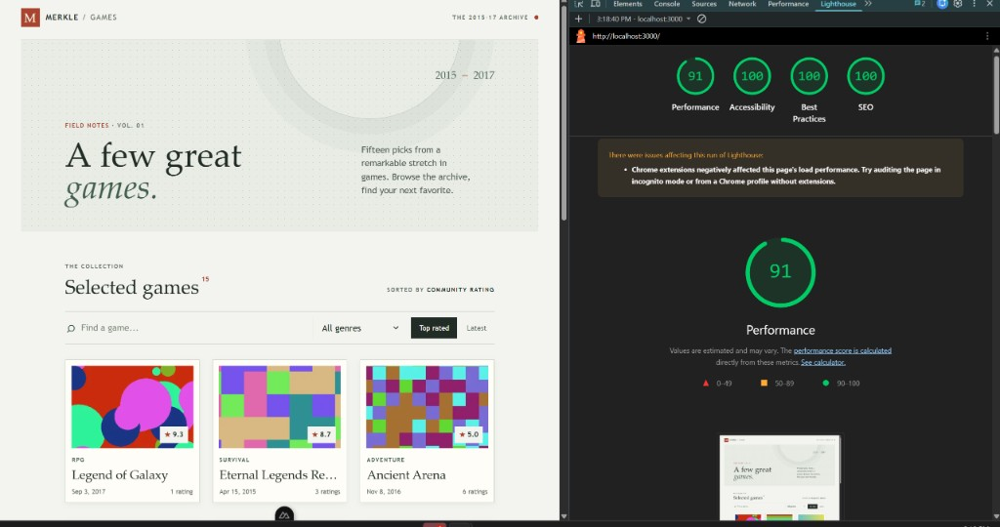

# Merkle Games

Merkle Games is a full-stack game archive with a REST and GraphQL API and a Nuxt 4 web client. Browse games released between 2015 and 2017, filter and sort the collection, and view game details, artwork, ratings, and player reviews.

## Project structure

- [`client/`](./client/) — Nuxt application and client tests.
- [`server/`](./server/) — Express API, GraphQL service, SQLite database, and server tests.

See the [server README](./server/README.md) for API setup, architecture, and API documentation.

```text
client/
  app/
    assets/scss/       Shared variables and global styles
    components/        Shared labels, feedback, artwork, shell, cards, and skeleton
    composables/       API access and reusable reactive sorting
    layouts/           Shared page shell
    pages/             Browse and game detail routes
    utils/api/         Retry and HTTP error handling
    utils/game/        Game selection, sorting, formatting, stats, and images
    constants.ts       Shared application and API configuration
  tests/               Vitest utility and API tests
```

## Requirements

- Docker and Docker Compose for the API, or Node.js 24+ and npm 10+ to run it directly.
- Node.js 20.19+ and npm 10+ for the client.
- The API running locally (default: `http://localhost:8000`; see [server setup](./server/README.md)).

## Run locally

Start the API in Docker:

```powershell
Set-Location server
Copy-Item .env.example .env
docker compose up --build
```

In another terminal, configure and start the client:

```powershell
Set-Location client
Copy-Item .env.example .env
npm ci
npm run dev
```

Open <http://localhost:3000>.

## Client environment variables

Copy `client/.env.example` to `client/.env` and set these values for local development (or in your deployment environment). Restart the Nuxt dev server after any `.env` change.

| Variable | Scope | Purpose |
| --- | --- | --- |
| `NUXT_API_BASE` | Server only | Direct upstream API URL for SSR fetches and the Nitro proxy target (e.g. `http://localhost:8000/api/v1`). |
| `NUXT_PUBLIC_API_BASE` | Public | Browser-facing, same-origin path for JSON API requests (e.g. `/api/v1`). Nuxt proxies this to `NUXT_API_BASE` in dev and via `routeRules` in production. |
| `NUXT_PUBLIC_MEDIA_BASE` | Public | Absolute API origin for game cover and media URLs in the browser (e.g. `http://localhost:8000`). JSON API traffic stays on `NUXT_PUBLIC_API_BASE`. |

Example (matches `client/.env.example`):

```env
NUXT_API_BASE=http://localhost:8000/api/v1
NUXT_PUBLIC_API_BASE=/api/v1
NUXT_PUBLIC_MEDIA_BASE=http://localhost:8000
```

### SSR and data caching

On the first load of a page, game data is fetched on the server and serialized into the Nuxt payload; the browser hydrates from that payload instead of issuing duplicate game JSON API calls on first paint. Client-side navigation to routes that have not been visited yet fetches data as needed. When you navigate back to a page you already opened, composables reuse cached `useAsyncData` results via `getPersistedAsyncData` unless you trigger a manual retry or refresh. Changing `.env` requires restarting `npm run dev`.

## Client architecture

`app.vue` mounts the default Nuxt layout around the current page. The layout provides a shared site shell, skip link, header, and footer. Pages contain route-specific data and markup; components encapsulate reusable interface elements and their scoped SCSS.

The API composable is the only layer that performs HTTP requests. It uses `fetchWithRetry` to retry transient network failures and HTTP 408, 429, and 5xx responses up to two times, with a short exponential delay. Other client errors fail immediately. Pages map common HTTP statuses to useful error messages and offer a manual retry action.

## Client functionality

- The browse page requests game IDs in the configured 2015–2017 release window, samples up to 15 unique IDs, and fetches game details and rating statistics.
- Search filters the selected games by title; genre filtering and rating/date sorting operate on that same set.
- Detail pages show game information, artwork, ratings, and reviews.
- Missing or broken artwork uses the local fallback image.
- API requests use Nuxt lazy data loading. Game cards are lazy-loaded components and their images use native browser lazy loading. Page and component SCSS is scoped and can be split with the corresponding Nuxt chunks.
- Loading skeletons, empty states, retry actions, accessible focus styles, and reduced-motion behavior are provided.

## Index page flow

1. Fetch IDs for the configured release-date range.
2. Deduplicate and randomly sample up to 15 IDs without changing the API response.
3. Fetch each selected game's details and statistics through the retry-enabled API composable.
4. Combine the API statistics with review-based fallbacks, then display the results.
5. Apply title/genre filters and the selected sort order in computed state; no watchers are needed.

## Client styling

- `client/app/assets/scss/variables.scss` defines shared color, typography, and layout tokens.
- `client/app/assets/scss/main.scss` imports those tokens and contains only global resets and accessibility helpers.
- Layout, page, and component styles live alongside their Vue files in `<style scoped lang="scss">` blocks.
- Sass is used for Vue component styles; Nuxt/Vite handles page-level CSS splitting during builds.

## Services

| Service | URL |
| --- | --- |
| Web client | <http://localhost:3000> |
| REST API | <http://localhost:8000/api/v1> |
| Swagger API docs | <http://localhost:8000/api-docs> |
| GraphQL endpoint | <http://localhost:8000/graphql> |
| GraphQL Playground | <http://localhost:8000/graphql-sandbox> |
| Health check | <http://localhost:8000/health> |

## Tests

Run the client tests from `client/`:

```sh
npm test
npm run build
```

Vitest covers game selection, sorting, formatting, statistics, image URLs, the sort composable, retry boundaries, retry limits, and API status messages.

Run the server tests from `server/`:

```sh
npm test
```

## Lighthouse

Homepage audit against a local production preview at <http://localhost:3000>:



*Performance 91; Accessibility, Best Practices, and SEO 100. Chrome extensions can skew load metrics—audit in incognito or a profile without extensions if you need a clean performance run.*
